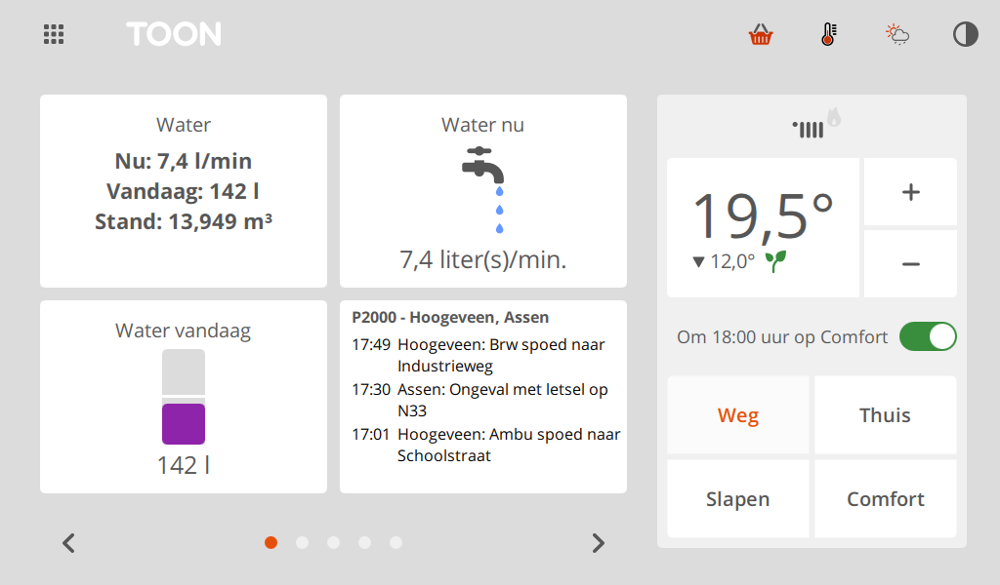
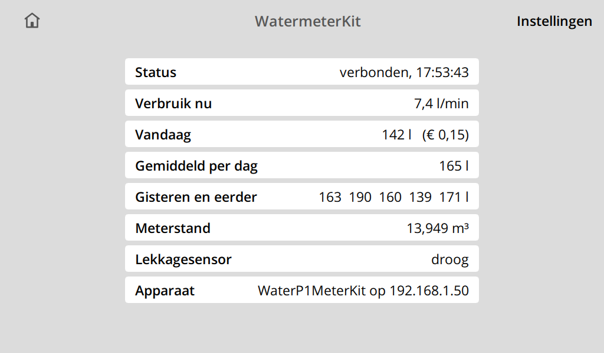
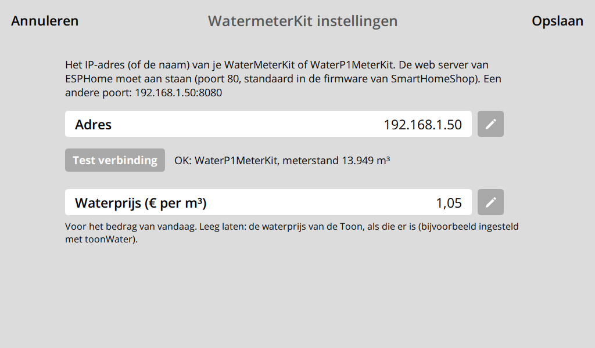

# WatermeterKit for Toon

A Toon app that shows your water usage from a SmartHomeShop
[WaterMeterKit](https://github.com/smarthomeshop/watermeterkit) or
[WaterP1MeterKit](https://github.com/smarthomeshop/waterp1meterkit). It reads the kit directly over
your home network through ESPHome's built-in web server, so you don't need Home Assistant, Domoticz
or a cloud account. It is modelled on [toonWater](https://github.com/oepi-loepi/toonWater).

## What you get

- **Three tiles:**
  - **WatermeterKit:** the flow now, today's usage and the meter reading.
  - **Water nu:** the Toon's animated tap, which runs harder as the flow goes up.
  - **Water vandaag:** today's usage as a bar against your daily average.
- **A details screen** (tap any tile):
  - status, flow and today's usage, in € too once you enter a water price
  - the daily average, the last 7 days, the meter reading, and which kit was found
- **Leak warning:** the WaterP1MeterKit V3 and later have a leak sensor. When it detects water, the
  tile shows **LEKKAGE!** in red.
- **Settings screen:** you enter the kit's address and your water price, and a **Test verbinding**
  button checks the address.

## Screenshots

The three tiles on the home screen (top left, top middle, bottom left; the P2000 tile is another app):



The details screen and the settings screen:





The screenshots come from the Toon simulator (Toon 2) with sample data.

## What you need

- A **rooted Toon** (Toon 1 or Toon 2) with the ToonSoftwareCollective (TSC) software, so it can run
  custom apps.
- A **WaterMeterKit** (V1, V2 or V3) or **WaterP1MeterKit** (V1 to V4) on SmartHomeShop's standard
  ESPHome firmware, on the same network as the Toon.
- The **IP address of the kit.** You can find it in your router's list of connected devices, or in
  Home Assistant under the device's settings. Give the kit a fixed IP address (a DHCP reservation in
  your router), so the Toon can keep finding it.

The standard firmware has ESPHome's web server switched on at port 80. To check it, open
`http://<kit-ip>/` in a browser: you should see the kit's sensor page.

## Installing on the Toon

1. **Copy the `watermeterKit` folder to the Toon**, to `/qmf/qml/apps/watermeterKit`. For example,
   from a PC with an SSH client (use your Toon's IP address):

   ```bash
   scp -r watermeterKit root@192.168.1.10:/qmf/qml/apps/
   ```

   With WinSCP on Windows: connect to the Toon with protocol **SCP**, user `root` and your Toon's
   root password, then drag the folder into `/qmf/qml/apps/`.

   The folder name must stay `watermeterKit`, spelled exactly like this (the Toon is case-sensitive
   and skips folders with a `-`). The files go directly inside it:
   `/qmf/qml/apps/watermeterKit/WatermeterKitApp.qml`.

2. **Restart the Toon's screen software.** Either use **Restart GUI** in the TSC settings on the Toon
   (the button appears once you unlock the TSC settings there), or run this over SSH:

   ```bash
   killall qt-gui
   ```

   The screen software starts again by itself within a minute.

3. **Add a tile.** On the home screen, tap an empty spot ("Voeg tegel toe") and choose
   **WatermeterKit**, **Water nu** or **Water vandaag**.

4. **Set the address.** Tap the tile, then **Instellingen** at the top right. Tap the pencil next to
   **Adres**, type the kit's IP address (for example `192.168.1.50`, or `192.168.1.50:8080` for a
   different port) and tap **Test verbinding**. You should see something like
   `OK: WaterP1MeterKit, meterstand 13.807 m³`.

5. **Optionally, enter your water price** in euros per m³ next to **Waterprijs** (for example `1,05`;
   your water company's bill shows it). The details screen then shows today's usage in euros too.

6. Tap **Opslaan**. The tiles fill in within 10 seconds.

## Setting the meter reading

The app shows the kit's **Water Meter Total**: the starting value you set in the kit, plus everything
counted since. If the reading doesn't match your physical water meter, set the starting value
(**Water Meter Initial Value**) on the kit's own web page at `http://<kit-ip>/` or in Home Assistant.
The Toon follows within 10 seconds.

## How "today" and the history work

- **Today** counts from the first reading after midnight, or from the moment the app first saw the
  kit, so the first day is shorter.
- At the start of each day, the previous day's usage goes into the history. The app keeps 7 days.
- The **average** is the average of those days.
- Setting a lower meter reading on the kit starts the day count again from the new value.

## Troubleshooting

| What you see | What to check |
|---|---|
| "Geen verbinding" on the tile | Is the kit on, and is the IP address still right? Open `http://<kit-ip>/` in a browser on the same network. |
| "Bereikbaar, maar geen meterstand-sensor..." | Something answers at that address, but it isn't a kit with SmartHomeShop's sensor names. Check the address, and see the next section if you changed the firmware. |
| The tile shows "-" or stays empty | Wait 10 seconds after saving. The flow shows 0 until the first water flows after the kit started. |
| The € amount is missing | Enter a water price in the app's settings (**Instellingen** on the details screen). If you leave it empty, the app uses a water price the Toon itself has, for example one set with toonWater. |

To see what the app reads, ask the kit directly from a PC:

```bash
curl "http://192.168.1.50/sensor/Water%20Meter%20Total"
```

The answer looks like `{"id":"sensor-water_meter_total","value":13.807,"state":"13.807 m³"}`. For a
WaterMeterKit, ask for `WaterMeterKit%20Water%20Meter%20Total` instead.

## Your own ESPHome configuration

The app looks for these sensor names, in this order:

| What | WaterP1MeterKit | WaterMeterKit |
|---|---|---|
| Meter reading (m³) | `Water Meter Total` | `WaterMeterKit Water Meter Total` |
| Flow (L/min) | `Water Current Usage` | `WaterMeterKit Current Usage` or `Current Usage` |
| Leak (binary sensor) | `Water Leak Sensor` | none |

It accepts both the URLs of current ESPHome (by name: `/sensor/Water%20Meter%20Total`) and those of
older ESPHome (by object ID: `/sensor/water_meter_total`). It remembers which one answered and looks
again if the firmware changes.

If you built your own YAML, keep these names and keep the web server on:

```yaml
web_server:
  port: 80
  version: 3
```

If you changed the kit's `friendly_name`, the WaterMeterKit's sensors are named differently and the
app won't find them.

## Trying it in toonsim

In the [Toon simulator](https://github.com/ToonSoftwareCollective/toonsim), put the folder in
`toonsim\apps\watermeterKit` and start the simulator, or use **TSC > Restart GUI** if it's already
running. Then continue from step 3 above. The simulator runs on your PC, so it can reach the kit on
your network. The tests are in `tests\test_watermeterkit.py`:

```bash
python\python.exe tools\run_tests.py watermeterkit
```

## Files and settings

| Where | What |
|---|---|
| `/qmf/qml/apps/watermeterKit/` | the app |
| `/mnt/data/tsc/watermeterKit.userSettings.json` | the kit's address, the water price, and which sensor URLs answered |
| `/mnt/data/tsc/appData/watermeterKit.days.json` | the start of today and the last 7 days |

The app also feeds the Toon's built-in water graphs:

- **Hours:** every 5 minutes it logs the flow (`water_flow`).
- **Days, weeks and months:** these are computed from the meter reading at each full hour
  (`water_quantity`). The app logs the reading taken when an hour starts as that hour's reading. They
  fill in from the moment the app runs, with no history from before.

The graphs only appear once water is enabled in the Toon's meter configuration (toonWater can do
that). This app doesn't change that configuration. When the Toon refuses a reading, the app logs its
answer once, as `watermeterKit: hcb_rrd refused ...`.

## Removing

Delete the folder `/qmf/qml/apps/watermeterKit` and the two settings files above, then restart the
screen software.
